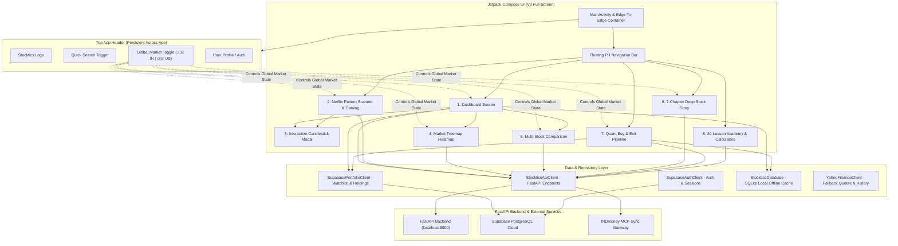
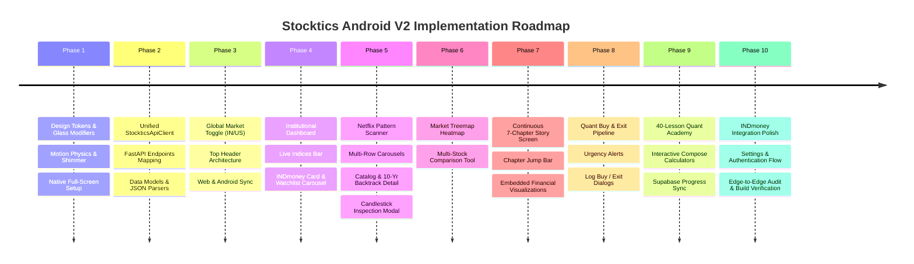

# Stocktics Android App V2 — End-to-End Rebuild Master Plan
*Tier-1 Institutional FinTech Architecture (Modeled after Groww & INDmoney)*

---

## 1. Executive Summary & Objective

The web application has achieved an institutional-grade standard with real-time quantitative scanning, 33 institutional pattern models, 7-chapter financial forensic storytelling, market treemaps, multi-stock comparison, INDmoney portfolio sync, and a 40-lesson quantitative academy.

The **Android App V2 Rebuild** brings **100% feature parity** with the web application into a native Jetpack Compose application designed to match the fluidity, speed, and aesthetics of **Groww** and **INDmoney**:
- **Full-Screen Edge-to-Edge Immersion**: Fully transparent system bars (`WindowCompat.setDecorFitsSystemWindows(window, false)`), native status bar and navigation bar insets, and fluid floating pill navigation.
- **Unified Global Market Switcher (`🇮🇳 IN` / `🇺🇸 US`)**: A single compact, high-precision toggle in the top header. When toggled, the **entire application** switches between Indian (NSE/BSE, Nifty, INR) and US (NYSE/NASDAQ, S&P 500, USD) contexts across all screens. No individual screens have redundant market buttons, maximizing vertical and horizontal screen real estate.
- **Modern Matte & High-Contrast Glass Aesthetics**: Deep Obsidian Black (`#0B0E14`), Slate Surfaces (`#141923`), 1dp Hairline Borders (`#222A3B`), frosted acrylic glass highlights, and purposeful Groww Mint (`#00D09C`) and Loss Red (`#F04438`).
- **Rich Micro-Animations**: Spring-scale bounce on touch (`animateFloatAsState` 0.97x on press), shimmer skeleton loaders, smooth tab slider physics, animated progress bars, and sliding modal sheets.
- **Fast & Responsive Native Performance**: Monospace tabular numbers, asynchronous coroutines, and local SQLite cache with automatic background sync to Supabase and the FastAPI backend.

---

## 2. Global Market Toggle Architecture (`IN` vs `US`)

### 2.1 The Problem It Solves
Previously, individual screens (Dashboard, Scanner, Heatmap, Compare, Buy Pipeline) each featured their own separate market switcher buttons, consuming valuable screen height and creating visual clutter.

### 2.2 The Global Toggle Solution (Web + Android)
A sleek, compact segmented pill toggle (`🇮🇳 IN` | `🇺🇸 US`) is housed persistently in the top app header:
- **Global Reactive State**:
  - `market = 'IN'`: The entire app focuses on Indian equities (Nifty 50, Sensex, NSE/BSE stocks, INR `₹` currency, Indian sector treemap, Indian 33-pattern setups).
  - `market = 'US'`: The entire app instantly switches to US equities (S&P 500, Nasdaq 100, NYSE/NASDAQ stocks, USD `$` currency, US sector treemap, US 33-pattern setups).
- **Persistent Memory**: Stored in `SharedPreferences` (Android) and `localStorage` (Web), so user preference is remembered across launches.
- **Screen Real Estate Saved**: Completely eliminates redundant market buttons from sub-screens, giving generous space for charts, financial stories, and quant metrics.

---

## 3. Web vs. Android Feature Parity Matrix

| Feature Module | Web Application Status | Android V1 Status | Android V2 Target Architecture |
| :--- | :--- | :--- | :--- |
| **Global Market Toggle** | Moving to Header Toggle | Inconsistent | **Global Header Toggle (`🇮🇳 IN` / `🇺🇸 US`)**: Controls entire app state simultaneously. |
| **Institutional Dashboard** | Net worth, indices, INDmoney sync card, watchlist carousel, daily quant picks | Basic overview cards | **Full Groww/INDmoney Dashboard**: Live indices bar, INDmoney sync card, quick action grid, watchlist sparklines, holdings preview. |
| **Pattern Scanner** | Netflix-style horizontal rows (33 setups), global market reactive, win rate %, score pills | Missing (only static explore categories) | **Netflix-Style Pattern Scanner**: Multi-row horizontal carousels reacting to global market state, live score badges. |
| **Patterns Catalog** | 33 patterns filtered by Bullish/Bearish/Reversal/Continuation | Missing | **Interactive Catalog Screen**: Filter chips, win rates, historical gain %, search, tap to open pattern deep dive. |
| **Pattern Detail Deep-Dive** | 10-yr backtrack stats, visual setup, matching stocks list | Missing | **Dedicated Pattern Screen**: Historical accuracy statistics (Win rate, Avg Return, Max Drawdown), live matching stock cards. |
| **Candlestick Pattern Inspection** | Full candlestick modal, breakout pivot, RSI/MACD, score diagnostic | Missing | **Inspection Modal/Sheet**: Jetpack Compose candlestick chart with volume, breakout lines, target/stop-loss levels, diagnostic reasons. |
| **Market Heatmap Treemap** | Treemap visual of S&P 500 or Nifty 500 sectors colored by return | Missing | **Interactive Compose Treemap Canvas**: Sector groupings, market cap tiles, green/red return intensity gradient, tap to inspect. |
| **Multi-Stock Comparison** | 2-5 stock side-by-side comparison, normalized % return chart, scorecard | Missing | **Stock Comparison Screen**: Search 2-5 stocks, normalized performance graph, comparative metrics across Valuation, Solvency & Growth. |
| **Deep Single-Stock Analysis** | 7-chapter continuous story, chapter jump bar, embedded financial charts | Basic rudimentary tabs | **Continuous 7-Chapter Story Screen**: Sticky horizontal jump bar, metric polarity filter, embedded interactive charts (Debt trajectory, Margins, Valuation gauge). |
| **Buy & Sell Quant Pipeline** | Unified Buy radar + Exit radar with stop loss, target, time stops, log dialogs | Separate basic tabs | **Unified Trading Pipeline**: Quant score filters, exit urgency triggers (Target hit, Stop-loss hit, Time stop), log buy/exit modals, realized P&L. |
| **Learning Academy** | 40 lessons (5 levels), interactive calculators (Compound, Risk-Reward, DCF) | Basic static list | **40-Lesson Academy**: Tiered progression (Level 1-5), interactive Compose calculators, Supabase completion progress sync. |
| **INDmoney Sync** | One-tap OAuth, syncs US & Indian holdings, cash balance, status card | Backend endpoints exist | **Native INDmoney Integration**: In-app auth prompt, sync status banner, auto-import holdings to local portfolio & Supabase. |

---

## 4. UI/UX Design System & Motion Engineering

### 4.1 Color Palette & Glassmorphic Surfaces (Groww + INDmoney Standard)
- **Background**: `#0B0E14` (Matte obsidian black, zero eye fatigue).
- **Surface Container**: `#141923` (Slate primary surface for cards and grouped containers).
- **Elevated Surface**: `#1C2333` (Input fields, interactive pills, and modal sheets).
- **Hairline Border**: `#222A3B` (Crisp 1dp stroke giving an institutional, authoritative feel).
- **Primary Brand (Groww Mint)**: `#00D09C` (Primary CTAs, positive returns, high buy scores).
- **Secondary Brand (INDmoney Blue)**: `#1455FE` (Exchange badges, tech tags, sync indicators).
- **Danger Action (Loss Red)**: `#F04438` (Stop losses, negative returns, sell triggers).
- **Warning Amber**: `#F59E0B` (Time-stop cautions, watchlist alerts).
- **Glassmorphism**: Translucent gradient `[#141923, #0F131C]` with top hairline specular border `[#334155, #1E293B]`.

### 4.2 Motion & Animation Design
1. **Interactive Card Press Bounce**:
   - Every card wrapped with spring-scale physics: scales down to `0.97f` on touch down, springs back to `1.0f` on release with `spring(dampingRatio = Spring.DampingRatioMediumBouncy)`.
2. **Shimmer Skeleton Loading**:
   - Asynchronous data loads render animated gradient shimmer placeholders (`FintechShimmer`) instead of empty screens or harsh spinners.
3. **Screen & Sheet Transitions**:
   - Fullscreen sub-views slide in vertically from the bottom (`slideInVertically + fadeIn`) and slide out smoothly (`slideOutVertically + fadeOut`).
4. **Interactive Chart Animations**:
   - Area and candlestick chart paths draw with an animated progress stroke (`Animatable(0f)` to `1f` on stock selection).
5. **Floating Pill Navigation Bar**:
   - Pill indicator glides horizontally between tabs with bouncy spring animation and subtle haptic feedback.

---

## 5. Architectural Blueprint

---

## 6. Implementation Phasing & Execution Plan

### Phase 1: Core Design System, Motion Physics & Edge-to-Edge Setup
- Configure full edge-to-edge transparent system bars with window insets in `MainActivity.kt`.
- Implement `FintechPressBounce` modifier (`animateFloatAsState` spring scale).
- Implement `FintechShimmer` placeholder modifier for smooth asynchronous loading.
- Refine `StockticsCard`, `StockticsButton`, `StockticsBadge`, and `StockticsTextField` according to the fintech rules.

### Phase 2: Unified API Client & Networking Layer
- Create `StockticsApiClient.kt` targeting the backend (`http://10.0.2.2:8000/api` for emulator or local IP / production URL).
- Add support for all endpoints: `/search`, `/stock/{ticker}`, `/stock/{ticker}/history`, `/scanner/categories`, `/scanner/pattern/{pattern}`, `/scanner/top-week`, `/scanner/stock/{ticker}/patterns`, `/scanner/backtest/{pattern}`, `/heatmap`, `/compare`, and `/indmoney/*`.
- Ensure resilient JSON parsing with offline fallback to existing SQLite `StockticsDatabase`.

### Phase 3: Global Header & Market Toggle (`IN` / `US`)
- Implement sleek segmented pill switch `[🇮🇳 IN | 🇺🇸 US]` in `SearchHeader.jsx` (Web) and `StockticsTopBar.kt` (Android).
- Wire global reactive state so all child screens update without needing local market switches.

### Phase 4: Institutional FinTech Dashboard
- Build `HomeScreenV2.kt` with live indices ticker (Nifty 50/Sensex when IN; S&P 500/Nasdaq when US), portfolio net worth card, INDmoney sync prompt, quick-action navigation grid, watchlist carousel with sparklines, active holdings summary, and daily top quant picks.

### Phase 5: Netflix-Style Pattern Scanner & Discovery Suite
- Build `PatternScannerScreen.kt` with multi-row horizontal carousels (Breakouts, Cup & Handle, Double Bottom, Bull Flag, etc.) powered by the active global market.
- Build `PatternsCatalogScreen.kt` with Bullish/Bearish/Reversal filters and 33-pattern search.
- Build `PatternDetailScreen.kt` with 10-year historical backtrack stats and matching stocks.
- Build `StockPatternInspectionSheet.kt` with native Compose candlestick canvas, volume bars, pivot overlay lines, and diagnostic scorecard.

### Phase 6: Market Heatmap & Multi-Stock Comparison
- Build `MarketHeatmapScreen.kt` with a squarified treemap canvas rendering sector groups and market-cap proportional tiles with green/red return intensity for the active market.
- Build `StockComparisonScreen.kt` with dynamic multi-stock search, normalized % performance chart, and comparative scorecard table.

### Phase 7: Continuous 7-Chapter Deep Stock Story
- Rebuild `StockDetailScreen.kt` into a continuous single-page story.
- Implement sticky chapter jump pills bar with scroll tracking.
- Embed interactive financial chart cards for Valuation, Solvency (Debt/Equity), Profitability (Margins), Cash Flow, and Ownership.
- Add technical pattern signals section detected for the stock.

### Phase 8: Quant Buy & Sell Pipeline with Exit Radar
- Build unified `QuantPipelineScreen.kt` with Buy Candidates and Holdings/Exit Radar tabs.
- Implement real-time exit signal triggers (`TARGET HIT`, `STOP LOSS TRIGGERED`, `TIME-STOP EXPIRED`).
- Connect `LogBuyDialog` and `LogExitDialog` to both local SQLite and cloud Supabase.

### Phase 9: 40-Lesson Quant Academy & Interactive Calculators
- Enhance `LearningScreen.kt` with 40 structured lessons across 5 tiers.
- Build interactive Compose calculators: Compound Interest Calculator, Position Sizing & Risk-Reward Calculator, and DCF Fair Value Simulator.
- Implement lesson completion checkmarks with Supabase persistence.

### Phase 10: INDmoney Sync Integration, Navigation & Compilation
- Implement native `IndmoneySyncDialog` and connect OAuth status.
- Wire all screens into `FloatingPillNavBar` and `MainAppScreen.kt` with smooth slide transitions.
- Polish guest mode and auth screens.
- Compile the entire Android project with Gradle (`./gradlew assembleDebug` and test tasks) using the installed Android Studio JDK.
